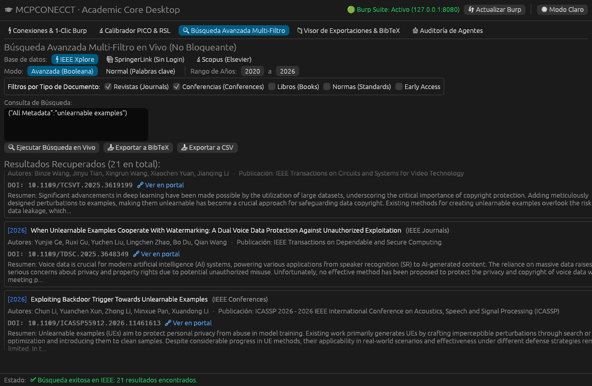
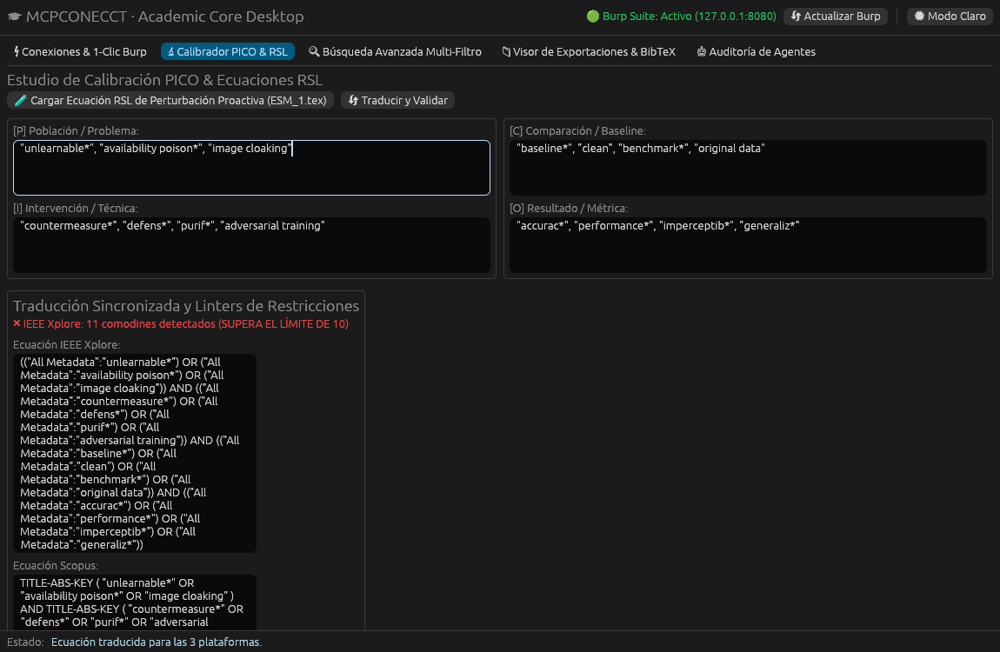
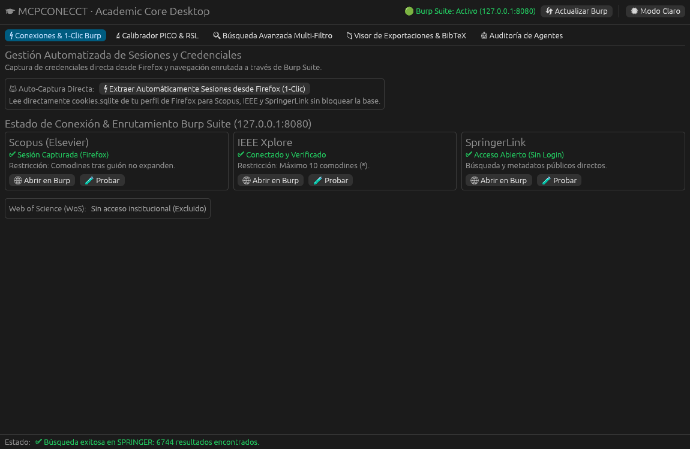
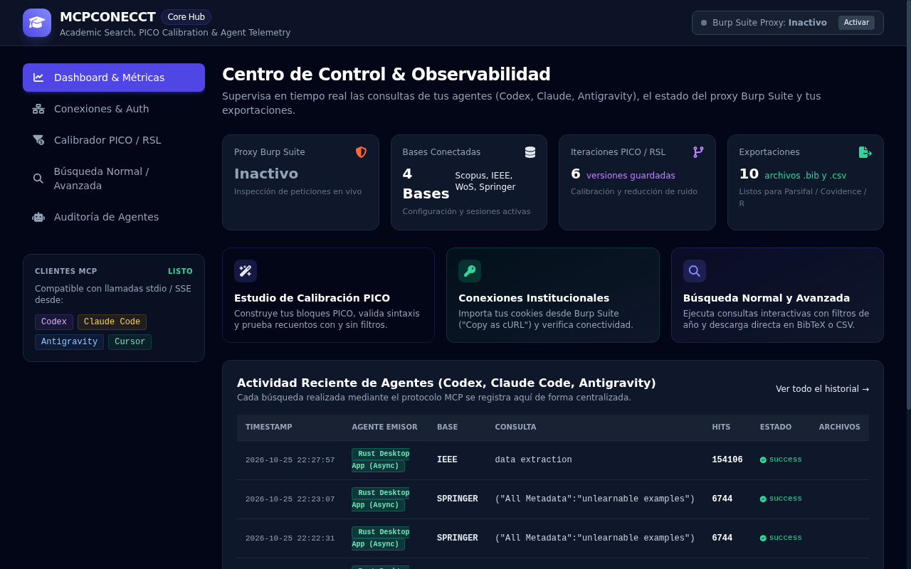
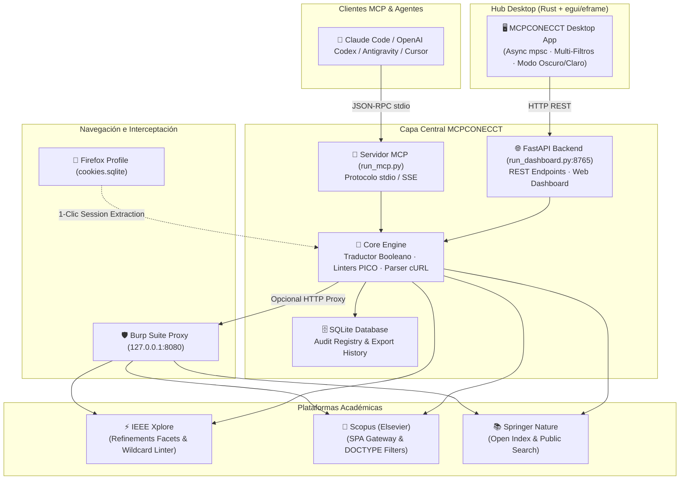

<div align="center">

# 🎓 MCPCONECCT
### Academic Literature Search, PICO Calibration & RSL Export Hub

[](https://github.com/glender222/MCPCONECCT)
[](https://python.org)
[](https://www.rust-lang.org)
[](https://modelcontextprotocol.io)
[](tests/)
[](LICENSE)

*Servidor Model Context Protocol (MCP) estándar y Hub Desktop de alto rendimiento para automatizar búsquedas académicas, calibrar ecuaciones PICO para Revisiones Sistemáticas de la Literatura (RSL / SLR) y exportar metadatos verificados a BibTeX y CSV.*

[Características](#-características-principales) • [Arquitectura](#-arquitectura-del-sistema) • [Instalación](#-instalación-rápida) • [Aplicación Desktop](#-aplicación-desktop-en-rust) • [Configuración MCP](#-configuración-con-clientes-mcp) • [Herramientas MCP](#-herramientas-mcp-disponibles)

<br/>



</div>

---

## 💡 ¿Por qué MCPCONECCT?

La investigación académica rigurosa y las Revisiones Sistemáticas (RSL / PRISMA) requieren consultar múltiples bases de datos indexadas (**IEEE Xplore**, **Scopus**, **SpringerLink**) enfrentándose a múltiples desafíos técnicos:

1. **Sintaxis Incompatibles**: Cada plataforma tiene su propio motor booleano (`TITLE-ABS-KEY` en Scopus vs. `All Metadata` en IEEE).
2. **Restricciones Ocultas de la API**: IEEE Xplore rechaza consultas con más de 10 comodines (`*`), mientras que Scopus no expande comodines tras guiones.
3. **Autenticación Compleja**: Las suscripciones institucionales usan pasarelas SSO/EZProxy que expiran rápidamente y son difíciles de integrar con agentes autónomos.
4. **Falta de Trazabilidad**: Los modelos de IA suelen generar citas alucinadas si no cuentan con acceso directo y verificable al corpus científico real.

**MCPCONECCT** resuelve este cuello de botella actuando como puente inteligente entre tus agentes de IA (**Claude Code, Codex, Antigravity, Cursor**) y los motores de búsqueda académicos, complementado con un **aplicativo de escritorio nativo en Rust** y un **dashboard de observabilidad web**.

---

## ✨ Características Principales

### 🔍 1. Búsqueda Avanzada Multi-Filtro en Vivo
- Consultas simultáneas o individuales a **IEEE Xplore**, **Scopus (Elsevier)** y **SpringerLink**.
- **Filtros nativos por tipo de documento**: Revistas (`Journals/Articles`), Conferencias (`Conferences`), Libros (`Books`), Capítulos de Libros y Normas (`Standards`).
- **Rango temporal configurable**: Filtrado estricto por años (`2020 a 2026`).
- **Renderizado enriquecido**: Visualización instantánea con título, autores, revista/congreso, año, DOI con enlace directo y abstract colapsable.

<br/>

### 🔬 2. Calibrador PICO & Linters de Sintaxis RSL
Diseña ecuaciones canónicas estructuradas en cuatro bloques fundamentales (**P**oblación, **I**ntervención, **C**omparación, **O**utcome).
- **Traducción automática y sincronizada**: Genera al instante la sintaxis válida para cada base de datos.
- **Linters de restricciones en tiempo real**: Detecta si una consulta supera el límite estricto de 10 comodines en IEEE Xplore o si presenta incompatibilidades en Scopus.

<div align="center">
  
</div>

<br/>

### ⚡ 3. Extracción de Sesiones en 1-Clic & Enrutamiento Burp Suite
- **1-Clic Firefox Extraction**: Lee de forma segura las cookies de sesión autenticadas directamente de tu perfil de navegador sin bloquear la base de datos de SQLite.
- **Soporte Burp Suite Proxy (`127.0.0.1:8080`)**: Inspecciona, depura y repite cualquier petición académica en tiempo real con bypass automático de SSL/TLS.
- **Modo Acceso Abierto**: SpringerLink opera al 100% en modo público directo sin necesidad de credenciales institucionales.

<div align="center">
  
</div>

<br/>

### 📊 4. Dashboard Web & Auditoría de Agentes
- Servidor web reactivo FastAPI con Tailwind CSS integrado.
- **Telemetría centralizada**: Registro de latencia, hits, parámetros y timestamps de cada consulta enviada por agentes autónomos.
- **Endpoints REST**: Acceso programático para herramientas externas (`/api/search`, `/api/export`, `/api/connections/test`).

<div align="center">
  
</div>

<br/>

### 📁 5. Exportador Masivo In-App a BibTeX y CSV
- Generación de citas académicas estandarizadas (`@article`, `@inproceedings`, `@book`) listas para gestores bibliográficos (**Zotero**, **Mendeley**, **Parsifal** o **Covidence**).
- Visor de archivos exportados con copia al portapapeles en un clic y apertura rápida del directorio del sistema.

---

## 🏗️ Arquitectura del Sistema



---

## 🚀 Instalación Rápida

### Requisitos Previos
- **Python**: `>= 3.10`
- **Rust & Cargo**: `>= 1.80` (para el aplicativo de escritorio)
- **Firefox** (opcional, para extracción automática de sesión institucional)

### 1. Clonar el Repositorio
```bash
git clone https://github.com/glender222/MCPCONECCT.git
cd MCPCONECCT
```

### 2. Configurar el Entorno Python
```bash
# Crear y activar entorno virtual
python3 -m venv venv
source venv/bin/activate

# Instalar dependencias
pip install --upgrade pip
pip install -e .
```

### 3. Configurar Plantillas de Autenticación
```bash
cp config/auth_store.example.json config/auth_store.json
cp .env.example .env
```

---

## 🖥️ Aplicación Desktop en Rust

El cliente desktop proporciona una interfaz gráfica reactiva y ultrarrápida compilada nativamente con **egui / eframe**.

### Ejecutar con Script Automatizado
```bash
./run_desktop.sh
```

### O Compilar con Cargo
```bash
cd desktop_app
cargo run --release
```

---

## 🌐 Iniciar Dashboard Web & Backend

```bash
# Inicia la API y el centro de control en http://127.0.0.1:8765
./venv/bin/python run_dashboard.py --port 8765
```

---

## 🔌 Configuración con Clientes MCP

### 1. Claude Desktop (`claude_desktop_config.json`)
*Ruta en Linux:* `~/.config/Claude/claude_desktop_config.json`  
*Ruta en macOS:* `~/Library/Application Support/Claude/claude_desktop_config.json`

```json
{
  "mcpServers": {
    "mcpconecct": {
      "command": "/ruta/absoluta/a/mcpconecct/venv/bin/python",
      "args": [
        "/ruta/absoluta/a/mcpconecct/run_mcp.py",
        "--transport",
        "stdio"
      ],
      "env": {
        "BURP_PROXY_ENABLED": "false"
      }
    }
  }
}
```

### 2. Cursor IDE (`.cursor/mcp.json`)
```json
{
  "mcpServers": {
    "mcpconecct": {
      "command": "/ruta/absoluta/a/mcpconecct/venv/bin/python",
      "args": ["/ruta/absoluta/a/mcpconecct/run_mcp.py", "--transport", "stdio"]
    }
  }
}
```

### 3. Antigravity & OpenAI Codex
Agrega el servidor a tu lista de servidores MCP en configuración JSON o invócalo directamente mediante el transporte estándar `stdio`.

---

## 🛠️ Herramientas MCP Disponibles

El servidor expone **10 herramientas estándar de alto nivel**:

| Herramienta | Parámetros Clave | Descripción |
| :--- | :--- | :--- |
| `validate_search_string` | `database`, `query` | Valida balanceo de paréntesis/comillas y restricciones de comodines (`*`). |
| `translate_search_string` | `query`, `target_databases` | Traduce una ecuación canónica a la sintaxis nativa de Scopus, IEEE y Springer. |
| `search_papers` | `database`, `query`, `year_start`, `year_end`, `doc_types`, `page_size` | Ejecuta la búsqueda en vivo y devuelve artículos con DOI, citas, autores y abstracts. |
| `get_paper_count` | `database`, `query`, `year_start`, `year_end`, `doc_types` | Conteo rápido de resultados totales (ideal para diagramas de flujo PRISMA). |
| `export_search_results` | `database`, `query`, `format`, `max_records`, `output_filename` | Exporta los resultados directamente a archivos `.bib` o `.csv` en `exports/`. |
| `import_curl` | `database`, `curl_command` | Extrae automáticamente cookies y headers copiados desde Burp Suite o DevTools. |
| `configure_auth` | `database`, `cookies`, `headers`, `api_key` | Guarda credenciales y tokens de forma persistente. |
| `test_connection` | `database` | Prueba conectividad real contra el portal académico y valida la sesión. |
| `get_database_status` | *ninguno* | Retorna el estado de conexión de las 3 bases soportadas y del proxy. |
| `configure_burp_proxy` | `enabled`, `proxy_url`, `disable_ssl` | Enruta el tráfico a través de Burp Suite (`http://127.0.0.1:8080`). |

---

## 🧪 Pruebas Automatizadas

El proyecto cuenta con una suite completa de pruebas unitarias y de integración que validan traductores, linters, parsers cURL y exportadores:

```bash
# Ejecutar suite de pruebas
pytest tests/ -v
```

Resultado:
```text
============================== 21 passed in 0.78s ==============================
```

---

## 📁 Estructura del Repositorio

```text
MCPCONECCT/
├── assets/                     # Capturas de pantalla e ilustraciones para documentación
│   ├── hero_desktop.png        # Interfaz de búsqueda multi-filtro en Rust
│   ├── connections_auth.png    # Panel de gestión de conexiones y Burp Suite
│   ├── pico_linters.png        # Calibrador PICO y validadores sintácticos
│   └── web_dashboard.png       # Dashboard web de métricas y telemetría
├── config/                     # Configuraciones y plantillas seguras
│   ├── auth_store.example.json # Plantilla de credenciales (auth_store.json en .gitignore)
│   ├── settings.py             # Parámetros del proxy y rutas
│   └── syntax_rules.json       # Reglas de comodines y sintaxis por biblioteca
├── core/                       # Núcleo analítico y traductores
│   ├── audit.py                # Base de datos SQLite para registro de agentes
│   ├── http_client.py          # Cliente HTTP con soporte proxy Burp y SSL bypass
│   ├── query_parser.py         # Analizador de sintaxis y balanceo
│   ├── query_translator.py     # Traductor a sintaxis canónica / nativa
│   └── query_validator.py      # Linter de límites de comodines por base
├── dashboard/                  # Dashboard web reactivo (FastAPI + Tailwind)
│   ├── routes/                 # Endpoints REST y vistas web
│   └── templates/              # Vistas HTML / Tailwind
├── desktop_app/                # Aplicación Desktop nativa en Rust (egui/eframe)
│   ├── src/                    # Código fuente en Rust (app, burp, db, translator)
│   └── Cargo.toml              # Manifiesto de paquetes Rust
├── exporters/                  # Generadores de formatos de salida
│   ├── bibtex_exporter.py      # Generador de archivos .bib
│   └── csv_exporter.py         # Generador de archivos .csv
├── exports/                    # Directorio de salida de exportaciones (ignorado en git)
├── mcp_server/                 # Servidor oficial Model Context Protocol
│   ├── tools/                  # Definiciones de herramientas y esquemas Pydantic
│   └── server.py               # Servidor FastMCP
├── platforms/                  # Adaptadores a motores de búsqueda
│   ├── ieee.py                 # Integración IEEE Xplore con refinements nativos
│   ├── scopus.py               # Integración Scopus SPA Gateway y DOCTYPEs
│   └── springer.py             # Integración Springer Open Index
├── tests/                      # Suite de pruebas automatizadas (pytest)
├── .env.example                # Plantilla de variables de entorno
├── .gitignore                  # Exclusiones estrictas para seguridad y limpieza
├── LICENSE                     # Licencia MIT de código abierto
├── pyproject.toml              # Manifiesto Python y metadatos de versión 1.0.0
├── run_dashboard.py            # Script de inicio del Dashboard Web
├── run_desktop.sh              # Script de inicio del aplicativo Desktop
└── run_mcp.py                  # Script de inicio del servidor MCP stdio
```

---

## 📄 Licencia

Este proyecto está bajo la Licencia **MIT** - consulta el archivo [LICENSE](LICENSE) para más detalles.

